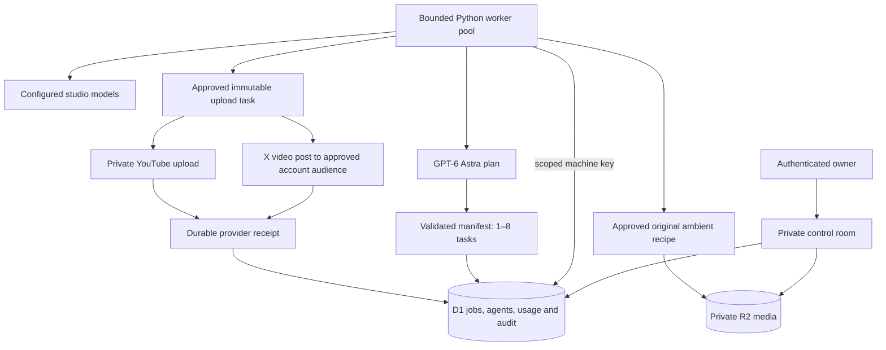

# Architecture and execution contract

The portal is a control plane, not an execution claim. Agent records describe configuration. Job records describe actual work. The distinction is visible in the UI: configured agent count, actual queued/running tasks, recent worker heartbeat and explicit live/rehearsal modes.

Astra's model is explicitly `gpt-6-astra`, a documented Responses API model with structured outputs. API account access is not inferred from availability in the Codex app. [OpenAI model documentation](https://developers.openai.com/api/docs/models/gpt-6-astra).

## Job lifecycle

A new workflow creates a `plan` job assigned to Astra. A completed manifest creates sequential `draft` children with a parent ID, prior dependency and one of three allowed roles. Within the fenced completion batch, the server resolves each role through account override, studio override and built-in fallback, in that order. It inserts each child with the selected agent in the same transaction; a losing completion cannot append children or use a stale preselected routing target. A model cannot add arbitrary tools, alter permissions, enqueue a publication or create accounts. User-supplied agent instructions are bounded input, and every model call receives fixed production boundaries.

`queued → running → succeeded | failed | uncertain`. A claimed job has a server timestamp, a unique lease token and a 180-second lease. The worker renews every 40 seconds. Completion is fenced by owner, job ID, running state, lease token and expiry; it uses an atomic batch with a unique completion marker. Losing competing callbacks cannot insert children or accounting rows. Identical completed callbacks are idempotent.

Model lease expiry requeues with a 30-second delay, to a maximum of three attempts. Unknown spend is retained in the usage ledger. Explicit model failures require operator retry. Dependency-blocked jobs recover after their dependency succeeds. Expired publishing leases enter `uncertain`; they are never automatically reuploaded. The local worker journal preserves dispatch intent, accepted provider receipts and pending completion payloads.

Claims enforce owner scope, due time, dependencies, attempt cap, inherited pauses, per-agent concurrency, workspace concurrency, reservations and publishing eligibility in the same SQL update. A stable claim request ID prevents an ambiguous HTTP retry from claiming a second task. Each SQL statement is separately prepared; transactionally related statements run in a D1 batch.

## Media and publication

R2 stores immutable per-upload objects under owner-scoped random keys. D1 stores name, size, rights basis, evidence and expiry. The API requires MP4 container bytes and a size under 50 MB. Container recognition is not full codec or malware validation; FFmpeg decoding is part of the local rendering workflow. Browser and worker downloads are authenticated, including byte-range playback.

A publication approval names an exact source object, account, title, description, schedule and AI-label choice. The server requires the platform-specific approval scope: `youtube-private` or `x-account`. X captions are checked with the official weighted-text parser before a job exists. The X queue title is internal; only the exact approved brief becomes post text. These fields have no editing endpoint after creation. A partial unique index prevents a second queued, running, uncertain or successful publication for the same asset in the workspace. Rights and pauses are rechecked at claim and immediately before the provider request. The YouTube worker validates the OAuth channel ID and always uploads privately. The X worker verifies the numeric OAuth user identity, uploads video chunks, waits for processing within expiry limits and creates a post for the account’s audience, which may be public. Both adapters use fixed provider endpoints. The operator verifies publication receipts in the platform.

## Authentication and secrets

Browser identity comes from dispatch-owned Sites sign-in. The production boundary must strip and replace all `oai-authenticated-user-*` headers. Never expose the unwrapped Vinext application on an untrusted standalone network: those headers are trusted only behind the authenticated Sites gateway. Local sign-in middleware strips spoofed headers and applies a development identity only to loopback requests.

Worker keys contain 256 random bits; only SHA-256 hashes are stored. They are owner-scoped and limited to claiming, heartbeats, completion, preflight and media retrieval. Keys cannot mutate operator settings, register accounts or read the browser control room. Rotation and revocation are audited. Initial provider grants remain in the worker’s environment. X access and rotated refresh tokens additionally reside in a private directory on the persistent worker volume; they never enter portal records, model context or completion journals. The optional `deploy/machine-entry.mjs` wrapper rejects browser routes and strips browser identity headers for separately provisioned machine ingress. It does not provision that ingress or grant access to Sites-managed storage.

Browser writes require the same origin. Database statements are parameterized. Models have no shell, browser, engagement tools or arbitrary HTTP access. Provider requests use fixed HTTPS endpoints and reject redirects. Upload-session URLs must remain on the expected Google API host. Logs expose error categories rather than secrets or provider response bodies.

## Queued original ambient media

`render` jobs store an immutable `render_spec` containing bounded duration, noise/color enums and a server-generated seed. The operator’s stable request ID makes exact creation replay idempotent; reuse with changed title, recipe or start time fails. These are explicit one-time tasks on `ambient-editor`, rather than model-generated instructions. Model-token reservation applies only to `plan` and `draft`; render tasks still obey global and agent concurrency, due time, inherited pause, leases and three-attempt retry limits.

The worker executes a fixed original-only renderer command in a private temporary directory, without source-file or URL arguments. A semaphore permits one local render, while the existing heartbeat continues during execution. Process-group termination handles lost leases/timeouts. The renderer receives no provider/portal credentials. After MP4/provenance checks, the worker transfers bytes only to the configured portal’s `/api/render` endpoint.

The endpoint accepts only a scoped machine key plus current render job/lease headers. It bounds the request body before multipart parsing, recomputes SHA-256 and derives provenance from the server’s immutable recipe. Each attempt writes a distinct R2 object. A fenced D1 batch chooses one `(owner,source_job)` asset, attaches it to the job and records one media event. Losing attempts delete only their own unselected object; uncertain commit responses are reconciled before deletion. D1 and R2 are not one transaction, so rare orphan cleanup is still operational work.

Render completion requires the server-bound asset receipt and zero model tokens. The portal binding, rather than a possibly stale local journal, decides recovery across attempts. Lease expiry may safely requeue rendering; a new attempt recovers any canonical asset before encoding. A completed render never creates a publishing job or authorizes a public side effect. Generated-media provenance is an attestation from the authorized worker plus an integrity digest, not an independent content-origin detector.

## X publication recovery

Each credential reference has a serialized, atomically persisted refresh state. A durable `refresh-starting` checkpoint precedes the non-retried token request; an ambiguous refresh is quarantined until a new initial grant is supplied. File and directory synchronization precede dependent provider work. This design uses local process file locks and does not claim multi-host coordination.

The upload records preparation progress but never treats incomplete media as a created post. Immediately before the single create-post request, the worker persists `post-starting`. A canonical returned post receipt is preserved through intermediate journal write failures. A valid saved success can report completion without new provider traffic. Missing or malformed success receipts, ambiguous dispatch and uncertain saved outcomes cannot fall through into a second create-post request. The server’s existing publication lock and lease fencing also apply to X. No reply, quote, repost, follow, like or cross-account amplification endpoint is exposed.

## Capacity and remaining work

The current bounded implementation uses one D1 database, 13 built-in agents, a capped registry of up to one million configurable agent records, and up to 32 simultaneous tasks. Each page returns at most 60 jobs/accounts and 100 audit events; summary counts query the complete workspace. One D1 database is single-threaded and has a 10 GB storage limit. Million-job throughput requires measured performance, ownership-based sharding, archival and a different queue/execution strategy. [Cloudflare D1 limits](https://developers.cloudflare.com/d1/platform/limits/).

A capacity illustration—not a result: one million jobs/day averages 11.57 jobs/second. At 30 seconds per job, approximately 347 concurrent workers would be occupied before redundancy or burst headroom. At 1,500 tokens/job, demand would be 1.5 billion tokens/day. Neither these limits nor that spend is authorized or provisioned by a portal setting.

## Recurring account workflows

`schedules` stores account-specific briefs, elapsed-time cadence, the next nominal occurrence, mode, pause state, run limit/count and an optimistic edit revision. `jobs.schedule_id` and `jobs.occurrence` link every root and descendant. A partial unique index on owner/schedule/occurrence applies only to roots, allowing children to share immutable occurrence context.

Every live worker claim expands at most ten due schedules. Candidate selection filters pauses, account authorization, mode, limits and all unresolved jobs before its limit. The same eligibility query is used inside `INSERT … SELECT` to revalidate concurrent controls. A D1 transaction inserts a root, advances only the occurrence tied to that new root ID, and records one event. Advancement jumps over missed intervals while preserving cadence. A replay or competing expander cannot create or count the same root twice.

Generation snapshots the account’s studio and brief; completion propagates account/schedule/occurrence fields. Claims independently enforce schedule and account pause, plus the chosen studio pause even when the task is assigned to Astra. Changing schedule mode or brief does not rewrite existing work. Failed/blocked/uncertain descendants prevent overlap until resolved or safely discarded. These schedules produce production artifacts, never publication approval.

Operator saves use stable creation request IDs, optimistic revisions on edits, atomic audit records and rejection of previously used occurrence timestamps. The portal paginates schedules and can filter all jobs by schedule ID. This is bounded single-workspace orchestration; it does not provision a million running models, queue sharding or a 24/7 hosted worker by itself.

The supported Sites machine path uses two credentials: the site's existing machine-access token in `OAI-Sites-Authorization`, plus the application's scoped worker key in `Authorization`. Only the `Portal` HTTP client attaches the Sites token; model and social provider requests do not receive it. HTTPS and bearer-format validation reject malformed values before header construction, HTTP configuration errors are redacted, and authenticated requests refuse all redirects. No new Sites token was generated or rotated during development.

## Dynamic agent registry

Custom agents have immutable owner, parent, studio, canonical task role and depth. New agents require an existing, nonretired studio branch below depth eight. They are definitions only until a role assignment directs future work to them. Creating a record does not invoke a model. The one-million cap is checked in the insert statement against a transactionally maintained workspace counter; direct child counts include retired records and are maintained in the same creation batch. A stable creation request ID makes retries idempotent, including counters and audit events.

The regular workspace response returns only the thirteen core configurations and their status summary. The network endpoint loads a focus, at most eight ancestors and twelve children using `(owner,parent,id)`. Prefix search seeks from `(owner,search_name,id)` with a tuple cursor and a separate upper bound. The all-maximum-Unicode prefix uses a distinct query shape without an upper bound. Cursors must remain within the searched prefix. Search and routing references fetch at most twenty visible results plus one lookahead. Per-node status queries use `(owner,agent,status)`; assignments use `(owner,agent,scope,role)`. These page bounds do not bound the size of each agent’s job history or prove sustained claim throughput.

Assignments are explicit `(owner,scope,role)` rows, scoped to a studio or authorized account. Only same-owner, same-studio, same-role, nonretired targets can be selected. A paused target remains selected and holds work. Reset stores a null target while increasing revision, preserving history against stale reset/recreate writes. Configuration updates also use optimistic revision checks. Mutation and audit statements commit in one D1 batch.

Retirement atomically excludes built-in agents and custom agents with nonretired children, routing references or unresolved jobs. This serializes safely with child creation, role changes and completion-generated work. Restoration requires enabled, nonretired ancestors and retains a paused state. Parent links are immutable, preventing operator-created cycles. All claim and publishing preflight ancestry checks include retirement as well as pause.

`tests/benchmark_network.py` measured six actual indexed page query shapes over one million lightweight local SQLite definitions. The raw result is in `docs/NETWORK_BENCHMARK.json`. It contains no provider traffic, million-job backlog or live D1 capacity validation; the runtime, token budget and hosting constraints above remain in force.
