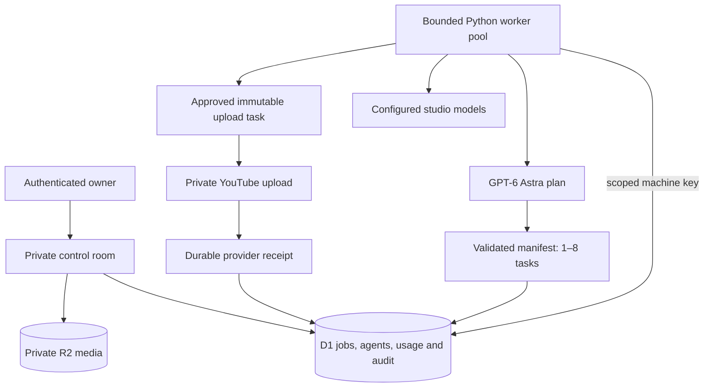

# Architecture and execution contract

The portal is a control plane, not an execution claim. Agent records describe configuration. Job records describe actual work. The distinction is visible in the UI: configured agent count, actual queued/running tasks, recent worker heartbeat and explicit live/rehearsal modes.

Astra's model is explicitly `gpt-6-astra`, a documented Responses API model with structured outputs. API account access is not inferred from availability in the Codex app. [OpenAI model documentation](https://developers.openai.com/api/docs/models/gpt-6-astra).

## Job lifecycle

A new workflow creates a `plan` job assigned to Astra. A completed manifest creates sequential `draft` children with a parent ID, prior dependency and one of three allowed roles. The server chooses each role's agent within the workflow's studio. A model cannot add arbitrary tools, alter permissions, enqueue a publication or create accounts. User-supplied agent instructions are bounded input, and every model call receives fixed production boundaries.

`queued → running → succeeded | failed | uncertain`. A claimed job has a server timestamp, a unique lease token and a 180-second lease. The worker renews every 40 seconds. Completion is fenced by owner, job ID, running state, lease token and expiry; it uses an atomic batch with a unique completion marker. Losing competing callbacks cannot insert children or accounting rows. Identical completed callbacks are idempotent.

Model lease expiry requeues with a 30-second delay, to a maximum of three attempts. Unknown spend is retained in the usage ledger. Explicit model failures require operator retry. Dependency-blocked jobs recover after their dependency succeeds. Expired publishing leases enter `uncertain`; they are never automatically reuploaded. The local worker journal preserves dispatch intent, accepted provider receipts and pending completion payloads.

Claims enforce owner scope, due time, dependencies, attempt cap, inherited pauses, per-agent concurrency, workspace concurrency, reservations and publishing eligibility in the same SQL update. A stable claim request ID prevents an ambiguous HTTP retry from claiming a second task. Each SQL statement is separately prepared; transactionally related statements run in a D1 batch.

## Media and publication

R2 stores immutable per-upload objects under owner-scoped random keys. D1 stores name, size, rights basis, evidence and expiry. The API requires MP4 container bytes and a size under 50 MB. Container recognition is not full codec or malware validation; FFmpeg decoding is part of the local rendering workflow. Browser and worker downloads are authenticated, including byte-range playback.

A publication approval names an exact source object, account, title, description and schedule. These fields have no editing endpoint after creation. A partial unique index prevents a second queued, running, uncertain or successful publication for the same asset in the workspace. Rights and pauses are rechecked at claim and immediately before the provider request. The YouTube worker validates the OAuth channel ID and always uploads privately. The operator verifies publication receipts in the platform.

## Authentication and secrets

Browser identity comes from dispatch-owned Sites sign-in. The production boundary must strip and replace all `oai-authenticated-user-*` headers. Never expose the unwrapped Vinext application on an untrusted standalone network: those headers are trusted only behind the authenticated Sites gateway. Local sign-in middleware strips spoofed headers and applies a development identity only to loopback requests.

Worker keys contain 256 random bits; only SHA-256 hashes are stored. They are owner-scoped and limited to claiming, heartbeats, completion, preflight and media retrieval. Keys cannot mutate operator settings, register accounts or read the browser control room. Rotation and revocation are audited. Provider credentials remain in the worker's environment. The optional `deploy/machine-entry.mjs` wrapper rejects browser routes and strips browser identity headers for separately provisioned machine ingress. It does not provision that ingress or grant access to Sites-managed storage.

Browser writes require the same origin. Database statements are parameterized. Models have no shell, browser, engagement tools or arbitrary HTTP access. Provider requests use fixed HTTPS endpoints and reject redirects. Upload-session URLs must remain on the expected Google API host. Logs expose error categories rather than secrets or provider response bodies.

## Capacity and remaining work

The current bounded implementation uses one D1 database, 13 configured agents and up to 32 simultaneous tasks. Each page returns at most 60 jobs/accounts and 100 audit events; summary counts query the complete workspace. One D1 database is single-threaded and has a 10 GB storage limit. Million-job throughput requires measured performance, ownership-based sharding, archival and a different queue/execution strategy. [Cloudflare D1 limits](https://developers.cloudflare.com/d1/platform/limits/).

A capacity illustration—not a result: one million jobs/day averages 11.57 jobs/second. At 30 seconds per job, approximately 347 concurrent workers would be occupied before redundancy or burst headroom. At 1,500 tokens/job, demand would be 1.5 billion tokens/day. Neither these limits nor that spend is authorized or provisioned by a portal setting.
